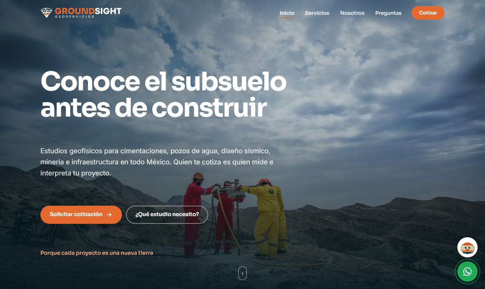

<div align="center">


### Sitio web de una empresa mexicana de estudios geofísicos

[](https://johannesquintanar-dev.github.io/groundsight/)




</div>

## En resumen

Proyecto real para una cliente: un sitio de 26 páginas que explica 18 estudios geofísicos a personas que no son especialistas y las lleva a pedir una cotización.

- **Catálogo como datos:** los 18 estudios viven en un solo archivo JS y un script de Node genera sus páginas, el sitemap y las tarjetas.
- **Asistente "¿Qué estudio necesito?"** y comparador de profundidades para orientar al cliente.
- **Rockie**, un chat guiado con botones (sin IA) que recomienda el estudio y, si no entiende, manda a WhatsApp con el mensaje ya escrito.
- **Cotización por correo y WhatsApp** sin servidor (FormSubmit).
- **Imágenes responsivas:** cada foto en WebP en cuatro anchos con `srcset`, generadas con `sharp`.
- **Sin dependencias en el navegador** ni proceso de build; se publica gratis en GitHub Pages.

---

## Documentación técnica

Sitio estático (HTML + CSS + JS, sin dependencias ni proceso de build) para la empresa de
estudios geofísicos de Brenda Pamela. Se publica gratis con GitHub Pages.

Ver **[REQUERIMIENTOS.md](REQUERIMIENTOS.md)** para el alcance, la información pendiente y la fase 2.

## Páginas

| Archivo | Contenido |
|---------|-----------|
| `index.html` | Inicio: hero, 5 métodos, por qué nosotros, cifras, sectores, proceso, llamada a cotizar |
| `servicios.html` | Los 18 estudios agrupados en 5 categorías, con profundidad, aplicaciones y entregable |
| `nosotros.html` | La especialista, principios de trabajo, cobertura y equipo |
| `preguntas.html` | Preguntas frecuentes agrupadas por tema |
| `cotizar.html` | Formulario de cotización (Gmail vía FormSubmit) y envío por WhatsApp |
| `aviso-privacidad.html` | Aviso de privacidad (texto modelo) |
| `creditos.html` | Créditos de las fotografías de bancos de imágenes |

## Estructura

```
assets/css/styles.css        Sistema de estilos y animaciones
assets/js/config.js          ← Correo, WhatsApp, nombre y cobertura (editar aquí)
assets/js/servicios.js       ← Catálogo de estudios, categorías y sectores (editar aquí)
assets/js/layout.js          Encabezado, pie de página y botón de WhatsApp compartidos
assets/js/main.js            Animaciones, navegación, render de servicios y formulario
assets/img/stock/            Fotografías de Wikimedia Commons (+ creditos-wikimedia.json)
assets/img/stock/ov/         Fotografías de Flickr vía Openverse (+ creditos-openverse.json)
```

## Cómo poner los datos reales

1. Abre `assets/js/config.js` y cambia `email`, `whatsapp` y `telefonoVisible`.
2. Sube el cambio. La primera vez que alguien envíe el formulario, **FormSubmit** mandará un
   correo de activación a ese Gmail: hay que abrirlo y pulsar *Activate* (una sola vez).
   **Ya está activado** para nuscaa.geoservicios@gmail.com (octubre de 2026); si se cambia el
   correo, habrá que activarlo de nuevo.

## Editar servicios

Todo el catálogo vive en `assets/js/servicios.js`. Cada estudio tiene `sigla`, `nombre`,
`prof` (profundidad típica), `desc`, `usos`, `entrega` y la categoría `cat`. Las páginas de
inicio, servicios y el formulario se generan solos a partir de esa lista.

## Fotografías

Son fotos reales de trabajo geofísico con licencia libre (CC BY / CC BY-SA / dominio público).
Los créditos se muestran en `creditos.html` y se leen de los archivos JSON de cada carpeta.
Al sustituirlas por fotos propias, conserva el nombre del archivo y borra su entrada del JSON.

Cada foto tiene versiones WebP en varios anchos (`nombre-480.webp`, `nombre-800.webp`, …; se regeneran con `node tools/resize.js --force`) que el
navegador elige según el tamaño de pantalla (`srcset`); el JPG original queda como respaldo. Al
agregar o cambiar una foto, vuelve a generar las versiones y el manifiesto `assets/js/imagenes.js`:

```bash
cd tools && npm i sharp && node resize.js
```

## Ver en local

```bash
npx serve .
```

## Fichas por estudio, asistente y comparador

- Los datos técnicos de cada estudio (alcance, días de campo, espacio necesario, límites) están en
  `assets/js/servicios.js` (`FICHAS`), junto con los objetivos del asistente (`OBJETIVOS`).
- Después de editar ese archivo, regenera las 18 páginas `estudio-*.html`, las tarjetas de
  `servicios.html`, `sitemap.xml` y `robots.txt`:

  ```bash
  node tools/generar-estudios.js
  ```

- El asistente "¿Qué estudio necesito?", el comparador de profundidades y el selector de
  aplicaciones están en `assets/js/herramientas.js`.

## Reseñas

- Los clientes las envían desde `resenas.html`; llegan al correo configurado en `config.js`.
- Para publicar una reseña autorizada, cópiala en `window.RESENAS` dentro de `assets/js/resenas.js`.
- Enlace para pedir reseña a un cliente después de un estudio: `https://groundsight.pages.dev/resenas?estudio=MASW`.
- Cuando exista el Perfil de Negocio de Google, pega su enlace "Escribir una reseña" en
  `resenasGoogle` de `config.js` y aparecerá el botón.

## Rockie (asistente del sitio)

- Rockie es un chat guiado, sin inteligencia artificial: hace preguntas con botones, recomienda el
  estudio con la misma lógica del asistente del inicio y contesta las preguntas frecuentes.
- Lo que no entiende lo manda a WhatsApp con el mensaje del cliente ya escrito; nunca inventa datos.
- Respuestas y palabras clave: `assets/js/rockie.js` (`FAQ` y `OBJ_KEYS`). El personaje está en
  `branding/rockie/` (SVG y PNG) para usarlo en redes sociales.
